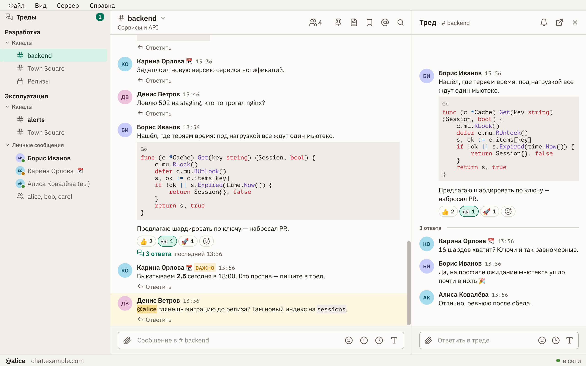
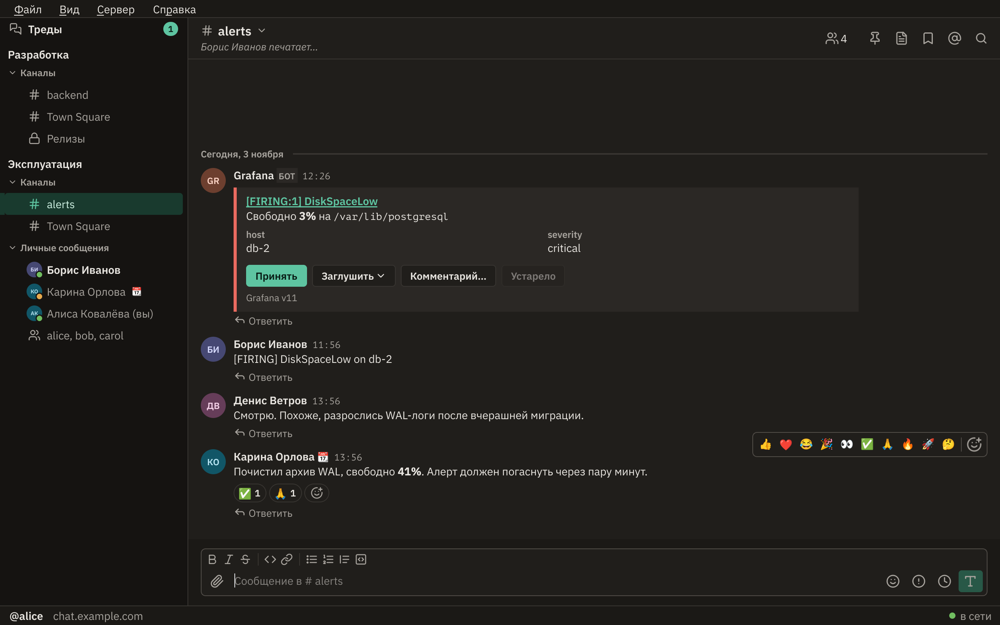

<p align="center">
  
</p>

<h1 align="center">Matterqute</h1>

<p align="center">A fast native <a href="https://mattermost.com">Mattermost</a> client for Linux, written in Go and Qt 6 — no Electron, no browser inside.</p>

<p align="center"><b>English</b> · <a href="README.ru.md">Русский</a></p>



## Why

- **Opens instantly.** Channels and recent messages come from disk at startup; syncing with the server happens in the background. Every channel's feed is prepared in advance, so switching channels loads and re-renders nothing.
- **Native.** A regular Qt window, a tray icon with an unread counter, desktop notifications, and `mattermost://` links from the browser open right in the app.
- **Plays well with the web client.** Sidebar categories, drafts, recent emoji, saved messages and the name display format are shared with the web client. Collapsed reply threads (CRT) work the same way they do there.
- **Never loses what you wrote.** Offline, you can read recent messages and keep writing: unsent messages go out on their own once the connection is back.

## Features

- **Messages:** a rich-text editor (no markdown symbols on screen, markdown is sent to the server), code highlighting, reactions and an emoji picker (with animated custom emoji), quoting, editing with edit history, "Important" and "Urgent" labels, scheduled sending, reminders, forwarding, spell checking.
- **Threads:** collapsed reply threads, the Threads list, following, a thread in its own window.
- **Channels:** categories and favorites, a separate unread group, browse, create and leave, members, archived channels, quick switcher on Ctrl+K.
- **Search:** messages and files; mentions, pinned and saved messages.
- **Files and media:** image previews and a full-screen viewer, GIFs, video playing right in the feed, link previews.
- **Integrations:** webhook attachments, bot buttons and menus, interactive dialogs, slash commands.
- **Status and notifications:** presence, a custom status with emoji and expiry, Do Not Disturb, automatic "Away" when idle. Notifications follow the same rules as in the web client.
- **Several servers** in one window, switching with Ctrl+1…9.
- **Appearance:** light, dark or system theme, fonts, zoom.



## Downloads

Prebuilt binaries are attached to each [release](https://github.com/dmitry-novozhilov/matterqute/releases): Linux x86_64 (an AppImage with Qt inside — `chmod +x` after downloading, nothing to install; Ubuntu 22.04+, Debian 12+; `--install` adds a menu entry), macOS on Apple Silicon (an unsigned `.dmg`: after copying the app run `xattr -dr com.apple.quarantine /Applications/Matterqute.app`) and Windows x86_64 (a `setup.exe` installer — no admin rights needed, registers `mattermost://` links — or a portable `.zip`; both unsigned). macOS and Windows builds are produced by CI but have not been tried by hand.

## Building

You need Go 1.24 or newer (it fetches the required toolchain by itself) and Qt 6.4+. On Debian 13:

```sh
sudo apt install qt6-base-dev qt6-svg-dev qt6-image-formats-plugins qt6-multimedia-dev build-essential pkg-config
sudo apt install libhunspell-1.7-0 hunspell-ru hunspell-en-us   # optional: spell checking
```

```sh
go build ./cmd/matterqute   # the first build takes about 10 minutes: the Qt bindings get compiled
./matterqute --install      # menu entry, icons, mattermost:// link handler
./matterqute
```

The fonts (IBM Plex Sans, PT Mono, Noto Color Emoji) are embedded in the binary, no need to install them.

## Development

```sh
go run ./cmd/mmfake   # a fake Mattermost server on 127.0.0.1:8065, sign in as alice / secret
go test ./...         # UI tests start a real Qt (offscreen when there is no display)
```

The code layout and conventions are described in [CLAUDE.md](CLAUDE.md), the user guide is in [docs/help](docs/help) (both in Russian). The screenshots above are taken by a test against the fake server: `QT_SCALE_FACTOR=2 MATTERQUTE_README_SHOTS=$PWD/docs/screenshots go test ./internal/ui -run TestReadmeScreenshots`.

## Status

Tested on Linux (Debian 13, X11, XFCE) with Mattermost server 11.6.2. The interface is in Russian. Windows and macOS have not been tested.

## Built with

[MIQT](https://github.com/mappu/miqt) (MIT): Qt 6 for Go; Qt is linked dynamically under the LGPL. The [Mattermost API client](https://github.com/mattermost/mattermost/tree/master/server/public) (Apache-2.0). Markdown by [goldmark](https://github.com/yuin/goldmark) (MIT), code highlighting by [chroma](https://github.com/alecthomas/chroma) (MIT). Icons from [Lucide](https://lucide.dev).

## License

[MIT](LICENSE). Bundled third-party files keep their own licenses: the fonts in [internal/theme/fonts](internal/theme/fonts) are under the SIL OFL 1.1; most icons in [internal/theme/icons](internal/theme/icons) come from Lucide (ISC, some from Feather under MIT — see its [LICENSE](internal/theme/icons/LICENSE)), while the four `status-*.svg` were drawn for this project (MIT); the emoji groups are built from Unicode data ([Unicode License V3](internal/emoji/LICENSE-unicode.txt)).

Mattermost is a trademark of Mattermost, Inc. Matterqute is an independent project, not affiliated with Mattermost, Inc.

<!-- CC-TOKENS:START -->
<abbr title="opus: 1.2 G ток, $367.70&#10;fable: 90.8 M ток, $114.29&#10;итого: 1.3 G ток, $481.99&#10;обновлено 2026-11-06 13:04 UTC · сессий: 4 (хостов: 1)&#10;прайс от 2026-11-06"></abbr>
<!-- CC-TOKENS:END -->
