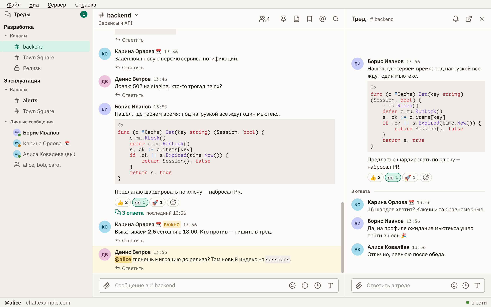
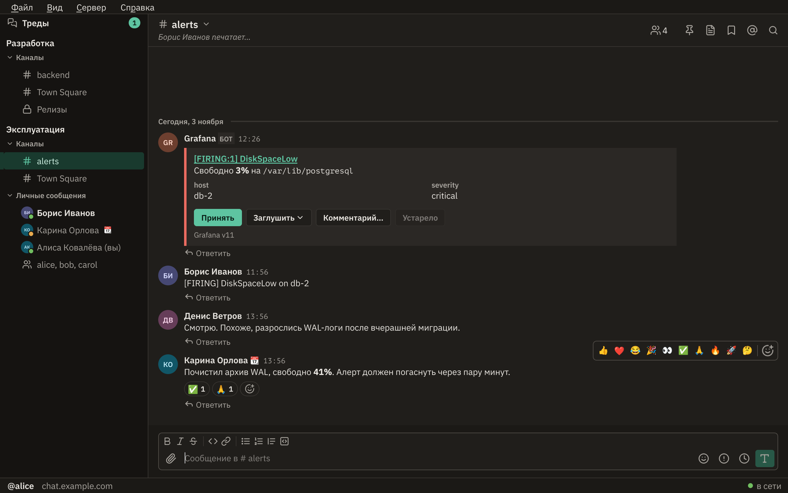

<p align="center">
  
</p>

<h1 align="center">Matterqute</h1>

<p align="center">Быстрый нативный клиент <a href="https://mattermost.com">Mattermost</a> для Linux на Go и Qt 6 — без Electron и браузера внутри.</p>

<p align="center"><a href="README.md">English</a> · <b>Русский</b></p>



## Чем хорош

- **Открывается сразу.** Каналы и последние сообщения при старте берутся с диска, а с сервером приложение сверяется в фоне. Ленты всех каналов готовы заранее, поэтому переключение между ними ничего не грузит и не перерисовывает.
- **Нативный.** Обычное окно Qt, значок в трее со счётчиком, уведомления рабочего стола, ссылки `mattermost://` из браузера открываются в приложении.
- **В ладу с веб-клиентом.** Категории сайдбара, черновики, недавние эмодзи, сохранённые сообщения и формат имён общие с веб-клиентом. Свёрнутые треды (CRT) работают так же, как там.
- **Не теряет написанное.** Без связи можно читать последние сообщения и писать: неотправленное уйдёт само, когда связь вернётся.

## Возможности

- **Сообщения:** редактор с оформлением (на экране без markdown-символов, на сервер уходит markdown), подсветка кода, реакции и окно выбора эмодзи (с анимированными эмодзи сервера), цитаты, правка и история правок, метки «Важно» и «Срочно», отложенная отправка, напоминания, пересылка, проверка орфографии.
- **Треды:** свёрнутые треды, список «Треды», подписка, тред в отдельном окне.
- **Каналы:** категории и избранное, непрочитанные отдельной группой, обзор, создание и выход, участники, архивные каналы, быстрый переход по Ctrl+K.
- **Поиск:** по сообщениям и файлам; упоминания, закреплённые и сохранённые сообщения.
- **Файлы и медиа:** превью картинок и просмотр во весь экран, GIF, видео прямо в ленте, предпросмотр ссылок.
- **Интеграции:** вложения вебхуков, кнопки и списки ботов, окна интеграций с полями, слэш-команды.
- **Статус и уведомления:** присутствие, свой статус с эмодзи и сроком, «Не беспокоить», автоматический «Отошёл» по простою. Уведомления приходят по тем же правилам, что в веб-клиенте.
- **Несколько серверов** в одном окне, переключение по Ctrl+1…9.
- **Вид:** светлая, тёмная или системная тема, шрифты, масштаб.



## Скачать

Готовые сборки приложены к каждому [релизу](https://github.com/dmitry-novozhilov/matterqute/releases): Linux x86_64 (один бинарник, собран на Debian 13, после скачивания `chmod +x`; нужны системные пакеты `libqt6widgets6 libqt6svg6 qt6-image-formats-plugins libqt6multimedia6`, Qt 6.8+), macOS на Apple Silicon (неподписанный `.dmg`: после копирования в «Программы» выполнить `xattr -dr com.apple.quarantine /Applications/Matterqute.app`) и Windows x86_64 (установщик `setup.exe` — без прав администратора, регистрирует ссылки `mattermost://` — или портативный `.zip`; оба без подписи). Сборки для macOS и Windows делает CI, руками они не проверялись.

## Сборка

Нужны Go 1.24 или новее (нужную версию тулчейна Go скачает сам) и Qt 6.4+. На Debian 13:

```sh
sudo apt install qt6-base-dev qt6-svg-dev qt6-image-formats-plugins qt6-multimedia-dev build-essential pkg-config
sudo apt install libhunspell-1.7-0 hunspell-ru hunspell-en-us   # по желанию: проверка орфографии
```

```sh
go build ./cmd/matterqute   # первая сборка — около 10 минут: компилируются биндинги Qt
./matterqute --install      # ярлык в меню, иконки, обработчик ссылок mattermost://
./matterqute
```

Шрифты (IBM Plex Sans, PT Mono, Noto Color Emoji) вшиты в бинарник, ставить их не нужно.

## Разработка

```sh
go run ./cmd/mmfake   # фейковый сервер Mattermost на 127.0.0.1:8065, вход alice / secret
go test ./...         # тесты интерфейса поднимают настоящий Qt (без дисплея — offscreen)
```

Устройство кода и соглашения описаны в [CLAUDE.md](CLAUDE.md), справка для пользователя лежит в [docs/help](docs/help). Скриншоты выше снимает тест на фейковом сервере: `QT_SCALE_FACTOR=2 MATTERQUTE_README_SHOTS=$PWD/docs/screenshots go test ./internal/ui -run TestReadmeScreenshots`.

## Состояние

Проверено на Linux (Debian 13, X11, XFCE) с сервером Mattermost 11.6.2. Интерфейс на русском. Windows и macOS не проверялись.

## Из чего сделано

[MIQT](https://github.com/mappu/miqt) (MIT): Qt 6 для Go, Qt подключается динамически под LGPL. [Клиент API Mattermost](https://github.com/mattermost/mattermost/tree/master/server/public) (Apache-2.0). Разметка — [goldmark](https://github.com/yuin/goldmark) (MIT), подсветка кода — [chroma](https://github.com/alecthomas/chroma) (MIT). Значки — [Lucide](https://lucide.dev).

## Лицензия

[MIT](LICENSE). Сторонние файлы в репозитории остаются под своими лицензиями: шрифты в [internal/theme/fonts](internal/theme/fonts) — SIL OFL 1.1; значки в [internal/theme/icons](internal/theme/icons) в основном из Lucide (ISC, часть из Feather под MIT — см. [LICENSE](internal/theme/icons/LICENSE)), а четыре `status-*.svg` нарисованы для проекта (MIT); разделы эмодзи собраны из данных Unicode ([Unicode License V3](internal/emoji/LICENSE-unicode.txt)).

Mattermost — товарный знак Mattermost, Inc. Matterqute — независимый проект, с Mattermost, Inc. не связан.
